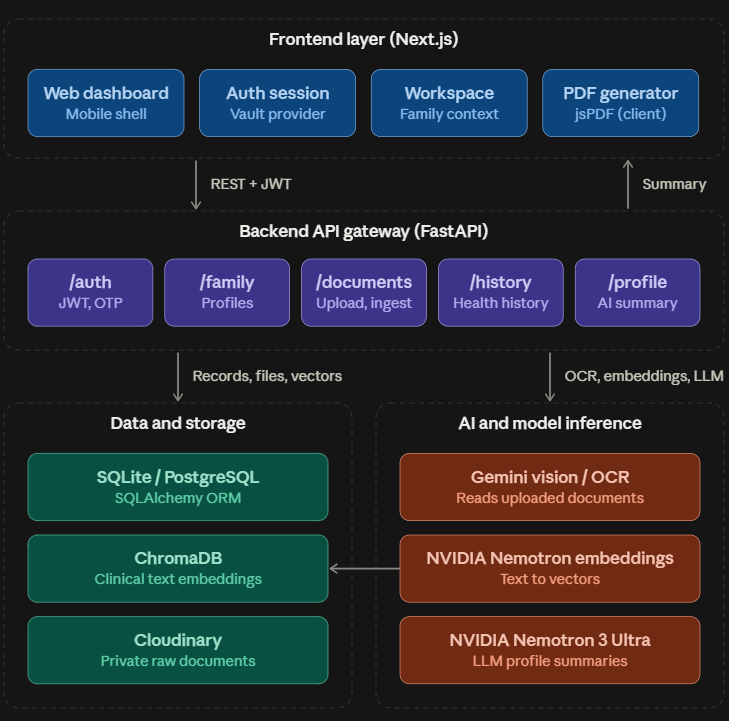
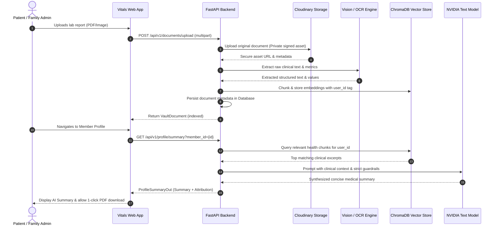

<div align="center">

  

  # **VITALS AI**
  ### *The Intelligent, Privacy-First Longitudinal Health Vault for Families*

[](https://python.org)
[](https://fastapi.tiangolo.com/)

[](https://www.trychroma.com/)
[](https://build.nvidia.com/)

[](https://nextjs.org/)


  <p align="center">
    Transforming scattered, unstructured medical paperwork into structured, longitudinal, per-member health vaults with AI-powered trend analysis, grounded clinical summaries, and privacy-first sharing.
  </p>

  [Features](#-core-features) • [Architecture](#-architecture--workflow) • [Installation Guide](#-quick-start--installation) • [Configuration](#-environment-variables) • [Project Structure](#-project-structure) • [Disclaimer](#-medical-disclaimer)

</div>

---

## 📌 Executive Summary

### The Problem
Patient and family medical records (prescriptions, diagnostic blood panels, discharge summaries, imaging reports) remain fragmented across loose PDFs, physical paper files, and messaging apps. When patients visit new physicians or manage chronic conditions (e.g., Diabetes, Hypertension, Dyslipidemia), clinicians miss critical longitudinal context due to incomplete or scattered medical histories. Traditional cloud storage acts as a passive **"file graveyard"** rather than an active health aid.

### The Solution
**Vitals AI** is a GenAI-powered digital health locker designed for modern families. It ingests unstructured records (scanned PDFs, paper photos, lab reports), extracts normalized clinical indicators into structured data, builds longitudinal timelines per family member, tracks vital biomarker trends, and delivers context-aware clinical summaries powered by **NVIDIA AI** and **ChromaDB vector embeddings**—all protected by strict medical safety guardrails.

---

## ✨ Core Features

* **📄 Multimodal Document Ingestion & OCR:** Upload lab reports, prescriptions, or imaging scans in PDF or image format (JPEG/PNG/HEIC). Powered by Vision models for high-accuracy clinical metric extraction.
* **👨‍👩‍👧‍👦 Unified Family Health Workspace:** Manage profiles for parents, children, and spouses under a single vault. Features auto-computed age from date of birth (never hand-edited) with age-appropriate biometric references.
* **📈 Longitudinal Trend Tracking:** Visualize biomarker trends over time (HbA1c, Fasting Glucose, Blood Pressure, Cholesterol, Triglycerides, Creatinine) with normal reference bands and alert levels.
* **🧠 Grounded NVIDIA AI Medical Summaries:** Automatic clinical summary synthesis powered by NVIDIA Nemotron LLMs referencing vector embeddings from user-uploaded records in ChromaDB.
* **🛡️ Two-Tiered Guardrailed Clinical Q&A:** Ask questions grounded strictly in your personal records with a deterministic red-flag interceptor preventing unauthorized diagnostic/treatment advice.
* **📋 Single-Page Health Profile & PDF Export:** One-click generation of professional A4 clinician summaries containing vital records, current conditions, medications, lab readings, and AI insights.
* **🔒 Privacy-by-Design & Zero-Knowledge Sharing:** Cloudinary private signed URLs (15-min preview, 5-min download) and time-bound share passes for secure physician consultations.

---

## 🏗️ Architecture & Workflow

### 1. System Architecture Diagram



---

### 2. Document Ingestion & AI Synthesis Workflow



---

## 🚀 Quick Start & Installation

### Prerequisites
- **Node.js**: v18.18.0 or higher
- **npm** or **pnpm**
- **Python**: v3.11 or higher
- **Git**

---

### 1. Clone the Repository

```bash
git clone https://github.com/your-username/vitals.git
cd vitals
```

---

### 2. Backend Setup (FastAPI)

1. Navigate to the backend directory:
   ```bash
   cd backend
   ```

2. Create and activate a Python virtual environment:
   ```bash
   # On macOS / Linux
   python3 -m venv .venv
   source .venv/bin/activate

   # On Windows (PowerShell)
   python -m venv .venv
   .venv\Scripts\Activate.ps1
   ```

3. Install backend dependencies:
   ```bash
   pip install -r requirements.txt
   ```

4. Configure your environment file:
   ```bash
   cp .env.example .env
   ```
   *(Ensure your database URL, Cloudinary credentials, and NVIDIA API keys are set in `.env`)*

5. Run the backend development server:
   ```bash
   uvicorn app.main:app --host 0.0.0.0 --port 8000 --reload
   ```
   *The interactive Swagger API documentation will be available at [http://localhost:8000/docs](http://localhost:8000/docs).*

---

### 3. Frontend Setup (Next.js)

1. Open a new terminal and navigate to the frontend directory:
   ```bash
   cd frontend
   ```

2. Install frontend dependencies:
   ```bash
   npm install
   ```

3. Configure your frontend environment:
   ```bash
   # .env
   NEXT_PUBLIC_BACKEND_URL=http://localhost:8000
   ```

4. Run the frontend development server:
   ```bash
   npm run dev
   ```

5. Open your browser and navigate to:
   ```
   http://localhost:3000
   ```

---

## ⚙️ Environment Variables

### Backend Configuration (`backend/.env`)

| Variable | Description | Default / Example |
|---|---|---|
| `DATABASE_URL` | Async SQLAlchemy database URL | `sqlite+aiosqlite:///./vitals.db` |
| `SECRET_KEY` | Secret key for signing JWT tokens | `generate-a-secure-random-string` |
| `ALGORITHM` | JWT hashing algorithm | `HS256` |
| `ACCESS_TOKEN_MINUTES` | Lifetime of access tokens | `30` |
| `REFRESH_TOKEN_DAYS` | Lifetime of refresh tokens | `7` |
| `CLOUDINARY_CLOUD_NAME` | Cloudinary account name | `your-cloud-name` |
| `CLOUDINARY_API_KEY` | Cloudinary API Key | `your-api-key` |
| `CLOUDINARY_API_SECRET` | Cloudinary API Secret | `your-api-secret` |
| `CLOUDINARY_FOLDER` | Upload destination folder | `vitals` |
| `CHROMA_PATH` | Local disk path for ChromaDB storage | `./chroma_db` |
| `CHROMA_COLLECTION` | ChromaDB collection name | `vitals_documents` |
| `TEXT_MODEL` | NVIDIA LLM model identifier | `nvidia/nemotron-3-ultra-550b-a55b` |
| `TEXT_MODEL_API_KEY` | NVIDIA API Key for LLM | `nvapi-...` |
| `EMBEDDING_MODEL` | NVIDIA Embedding model identifier | `nvidia/nemotron-3-embed-1b` |
| `EMBEDDING_MODEL_API_KEY` | NVIDIA API Key for Embeddings | `nvapi-...` |
| `OCR_MODEL` | Vision / OCR model identifier | `gemini-3.6-flash` |
| `OCR_MODEL_API_KEY` | API Key for Vision extraction | `AIza...` |

### Frontend Configuration (`frontend/.env`)

| Variable | Description | Default |
|---|---|---|
| `NEXT_PUBLIC_BACKEND_URL` | URL of the running FastAPI server | `http://localhost:8000` |

---

## 📁 Project Structure

```plaintext
vitals/
├── backend/                        # FastAPI Backend Application
│   ├── app/
│   │   ├── core/                   # App config, security & JWT utilities
│   │   ├── db/                     # Database engine & session management
│   │   ├── models.py               # SQLAlchemy ORM models (User, Family, Docs, History)
│   │   ├── schemas.py              # Pydantic request & response validation schemas
│   │   ├── deps.py                 # FastAPI authentication dependencies
│   │   ├── main.py                 # FastAPI application factory & router registration
│   │   ├── routers/                # API Endpoints
│   │   │   ├── auth.py             # Auth, Sign up, OTP verification, Profile update
│   │   │   ├── documents.py        # Upload, view, signed download, delete & indexing
│   │   │   ├── family.py           # Family member management & lineage
│   │   │   ├── history.py          # Medical history (conditions, treatments, allergies)
│   │   │   └── profile.py          # NVIDIA AI medical summary & vector search
│   │   └── services/               # Vectorstore (ChromaDB) & Cloudinary storage
│   ├── requirements.txt            # Python dependencies
│   └── vitals.db                   # Local SQLite database (auto-initialized)
│
├── frontend/                       # Next.js 16 App Router Frontend
│   ├── app/                        # Next.js App Router
│   │   ├── (app)/                  # Authenticated app route group
│   │   │   ├── layout.tsx          # App shell wrapper & navigation layout
│   │   │   ├── dashboard/          # Metric overviews, recent docs & AI chat
│   │   │   ├── documents/          # Document vault & report viewer
│   │   │   ├── profile/            # Single-page health profile, editable data & PDF
│   │   │   └── timeline/           # Longitudinal clinical events timeline
│   │   ├── auth/                   # Authentication routes (signin, signup, setup)
│   │   └── layout.tsx              # Root HTML & font providers
│   ├── components/                 # Reusable React components
│   │   ├── app/                    # App shell, workspace header, sidebar
│   │   ├── profile/                # AI summary, editable details grid, history dialogs
│   │   ├── dashboard/              # Metric cards, Ask-AI widget, recent doc carousel
│   │   └── ui/                     # Accessible design system (Buttons, Dialogs, Inputs)
│   ├── lib/                        # Client utilities, API client, Zod schemas, PDF engine
│   │   ├── api.ts                  # Type-safe API client with automatic token refresh
│   │   ├── profile-pdf.ts          # Single-page A4 health profile PDF generator
│   │   └── schemas.ts              # Zod validation schemas
│   └── public/                     # Static assets (logo.png, icons)
│
├── BUILD_PROGRESS.md               # Continuous build logs and session milestones
├── build.md                        # Comprehensive system specification & engineering spec
├── proposal.md                     # Hackathon project proposal & architecture
└── README.md                       # Project overview & documentation
```

---

## 📡 Key API Endpoints

| Method | Endpoint | Description |
|---|---|---|
| `POST` | `/api/v1/auth/signup` | Register new account and issue setup token |
| `POST` | `/api/v1/auth/setup` | Complete personal onboarding profile |
| `POST` | `/api/v1/auth/login` | Authenticate user and issue JWT token pair |
| `GET` | `/api/v1/auth/me` | Fetch authenticated user information |
| `PATCH`| `/api/v1/auth/me` | Update account holder profile (name, phone) |
| `GET` | `/api/v1/family/members` | List linked family member profiles |
| `POST` | `/api/v1/family/members` | Add a new family member |
| `GET` | `/api/v1/documents/all` | Retrieve all documents for the authenticated user |
| `POST` | `/api/v1/documents/upload`| Upload medical document, trigger OCR & vector indexing |
| `GET` | `/api/v1/documents/{id}/view` | Generate 15-minute signed Cloudinary preview link |
| `GET` | `/api/v1/documents/{id}/download`| Generate 5-minute signed attachment download link |
| `DELETE`| `/api/v1/documents/{id}`| Permanently delete document, file, and vector index |
| `GET` | `/api/v1/history` | List clinical history (conditions, medications, allergies) |
| `POST` | `/api/v1/history` | Record a medical history entry |
| `DELETE`| `/api/v1/history/{id}` | Remove a medical history entry |
| `GET` | `/api/v1/profile/summary` | Query ChromaDB and generate NVIDIA AI Medical Summary |

---

## 🛡️ Medical Disclaimer

> **IMPORTANT:** **Vitals AI** is an intelligent clinical document organizer and educational health summary tool. It is **not** a diagnostic engine, medical device, or replacement for qualified medical professionals. Vitals AI does not prescribe medication, adjust dosages, or authorize treatment changes. All extracted metrics and AI summaries should be reviewed and verified by a licensed healthcare provider before making any medical decisions.

---

## 🤝 Contributing

Contributions, bug reports, and feature requests are welcome!
1. Fork the Project.
2. Create your Feature Branch (`git checkout -b feature/AmazingFeature`).
3. Commit your Changes (`git commit -m 'Add some AmazingFeature'`).
4. Push to the Branch (`git push origin feature/AmazingFeature`).
5. Open a Pull Request.